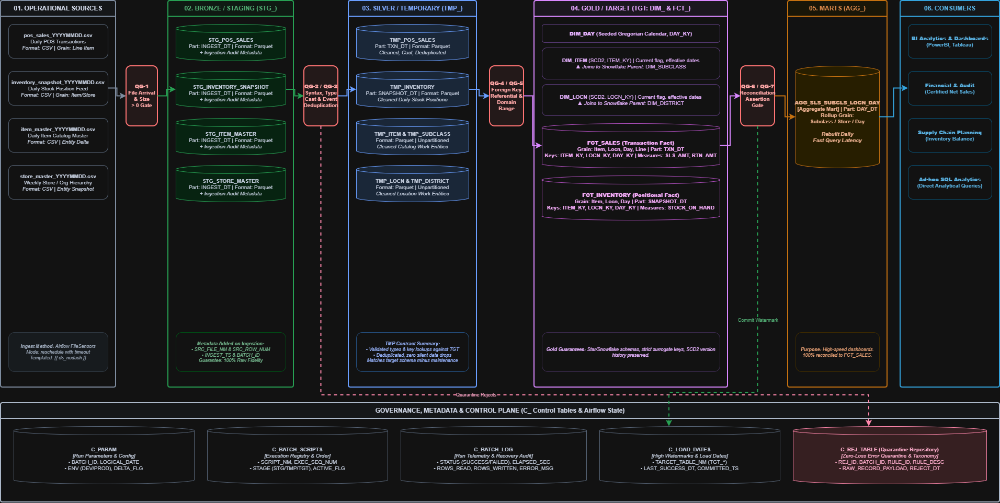

# 🏬 Retail Medallion ETL Pipeline

> **Module 2 — Assignment 2.3** · Apache Airflow 3 · Snowflake 



---

## Overview

A production-grade **Apache Airflow** pipeline that takes daily retail CSV drops through a **Bronze → Silver → Gold** medallion architecture into a fully verified **Kimball star/snowflake schema** on Snowflake.

### What This Pipeline Guarantees

| Guarantee | How |
|:--|:--|
| **Raw fidelity** | Every source row lands in Bronze with audit metadata (`SRC_FILE_NM`, `SRC_ROW_NUM`, `INGEST_TS`, `BATCH_ID`) |
| **Defect quarantine** | Bad rows (null keys, negative quantities, orphan FKs, duplicates) go to `C_REJ_TABLE` — never silently dropped, never passed downstream |
| **Dimensional integrity** | Parent hierarchies load first; SCD Type 2 tracks `DIM_ITEM` and `DIM_LOCN` with surrogate integer keys and effective-date ranges |
| **Idempotency** | Any date re-runs with identical row counts, surrogate keys, and financials — zero drift |
| **Reconciliation gate** | Bronze ↔ Silver ↔ Gold row counts and net sales must tie mathematically before watermarks advance |

---

## Data Flow

```
                          ┌──────────────────────────────────────────────────────┐
                          │              MEDALLION PIPELINE                      │
                          └──────────────────────────────────────────────────────┘

  ┌─────────────────┐         ┌─────────────────┐         ┌─────────────────┐
  │   SOURCES       │         │   BRONZE (STG_)  │         │  SILVER (TMP_)  │
  │                 │         │                 │         │                 │
  │  pos_sales.csv  │────────▶│ STG_POS_SALES   │────────▶│ TMP_POS_SALES   │──┐
  │  inventory.csv  │  File   │ STG_INVENTORY   │  Type   │ TMP_INVENTORY   │  │
  │  item_master.csv│ Sensors │ STG_ITEM_MASTER │  Cast,  │ TMP_ITEM        │  │
  │  store_master.csv│        │ STG_STORE_MASTER│  Dedup  │ TMP_LOCN        │  │
  └─────────────────┘         └─────────────────┘         └────────┬────────┘  │
                                                                   │           │
                                     ┌─────────────────────────────┘           │
                                     │  Defective rows                         │
                                     ▼                                         │
                              ┌─────────────┐                                  │
                              │ C_REJ_TABLE │  (quarantine with reason codes)  │
                              └─────────────┘                                  │
                                                                               │
  ┌────────────────────────────────────────────────────────────────────────────┘
  │
  │  ┌─────────────────────┐         ┌──────────────────┐       ┌─────────────┐
  │  │  GOLD DIMENSIONS    │         │  GOLD FACTS       │       │   MARTS     │
  │  │                     │         │                  │       │             │
  └─▶│  DIM_SUBCLASS (SCD1)│────────▶│  FCT_SALES       │──────▶│ AGG_SLS_    │
     │  DIM_DISTRICT (SCD1)│  Surr.  │  (transaction)   │ Full  │ SUBCLS_     │
     │  DIM_ITEM    (SCD2) │  Key    │                  │Rebuild│ LOCN_DAY    │
     │  DIM_LOCN    (SCD2) │  Joins  │  FCT_INVENTORY   │       │             │
     │  DIM_DAY     (seed) │         │  (positional)    │       │             │
     └─────────────────────┘         └──────────────────┘       └──────┬──────┘
                                                                       │
                                                                       ▼
                                                              ┌─────────────────┐
                                                              │ RECONCILIATION  │
                                                              │ Volume + Finance│
                                                              │ 3-way tie check │
                                                              └─────────────────┘
```

---

## Repository Structure

```
bootcamp/
├── dags/
│   ├── retail_etl_pipeline.py          Main DAG: retail_medallion_etl
│   ├── init_schema_dag.py              DDL deployment utility
│   └── subcomponents/
│       ├── sensors.py                  FileSensors (mode=reschedule)
│       ├── bronze_ingest.py            Dynamic task mapping via .expand()
│       ├── silver_clean.py             Quality cleaning + quarantine
│       ├── gold_dims.py                SCD1/SCD2 dimension builder
│       ├── gold_facts.py               Transaction + positional fact loader
│       ├── marts.py                    Daily aggregate mart
│       ├── reconciliation.py           Cross-layer reconciliation gate
│       └── snowflake_session.py        Snowflake connection helper
│
├── include/sql/
│   ├── ddl/                            Schema definitions
│   │   ├── init_control_tables.sql     C_PARAM, C_BATCH_LOG, C_LOAD_DATES, C_REJ_TABLE
│   │   ├── init_bronze_tables.sql      STG_* tables
│   │   ├── init_silver_tables.sql      TMP_* tables
│   │   ├── init_gold_tables.sql        DIM_*, FCT_*, AGG_* tables
│   │   └── run_all_ddl.sql            Execution sequence guide
│   ├── silver/                         Cleaning transforms
│   │   ├── clean_pos_sales.sql         POS cleaning + 4 quarantine rules
│   │   ├── clean_inventory.sql         Inventory dedup
│   │   ├── clean_item_master.sql       Item + subclass extraction
│   │   └── clean_store_master.sql      Store + district extraction
│   └── gold/                           Dimension & fact loads
│       ├── load_dim_subclass.sql       SCD1 MERGE
│       ├── load_dim_district.sql       SCD1 MERGE
│       ├── load_dim_item_scd2.sql      SCD2 with sequence keys
│       ├── load_dim_locn_scd2.sql      SCD2 with district reclassification
│       ├── load_fct_sales.sql          Transaction fact
│       ├── load_fct_inventory.sql      Positional fact
│       └── load_agg_sales.sql          Daily rollup rebuild
│
├── architecture/                       Architecture documentation
│   ├── architecture_diagram.png        Layer topology diagram
│   ├── layer_inventory.csv             Object-to-layer mapping (27 objects)
│   └── architecture_notes.md           Contracts, gates, retention, reload
│
├── data/                               Source CSV files (2026-03-01 to 2026-03-05)
├── tests/
│   └── test_dag_integrity.py           DAG parse, cycle, topology tests
├── evidence/
│   ├── backfill_grid_view.png   
│   ├── verification_queries_result.csv
│   └── verification_queries.sql        Post-backfill audit queries
│
├── docker-compose.yaml                 Airflow 3 cluster spec
└── README.md                           This file
```

---

## Setup

### Prerequisites

- **Docker Desktop** with Docker Compose (8 GB RAM allocated)
- **Snowflake account** with database/schema/sequence creation permissions

### 1. Start the Airflow Cluster

```bash
docker compose up -d
```

Open the Airflow UI at **http://localhost:8080** (credentials: `airflow` / `airflow`).

### 2. Configure Connections & Variables

In the Airflow UI, create the following:

**Connection — `retail_snowflake_conn`**

| Field | Value |
|:--|:--|
| Conn Id | `retail_snowflake_conn` |
| Conn Type | Snowflake |
| Login | *your Snowflake username* |
| Password | *your Snowflake password* |
| Schema | `RETAIL_DWH` |
| Extra | `{"account": "<your_account>", "warehouse": "COMPUTE_WH", "database": "RETAIL_DWH_DB", "role": "ACCOUNTADMIN"}` |

**Connection — `fs_default`**

| Field | Value |
|:--|:--|
| Conn Id | `fs_default` |
| Conn Type | File (path) |
| Extra | `{"path": "/opt/airflow/data"}` |

**Variable — `RETAIL_DROP_DIR`**

| Key | Value |
|:--|:--|
| `RETAIL_DROP_DIR` | `/opt/airflow/data` |

### 3. Initialize Snowflake Schema

Trigger the **`init_snowflake_schema_dag`** from the Airflow UI to deploy all DDL objects, or run the SQL files in `include/sql/ddl/` manually in a Snowflake worksheet.

---

## Running the Pipeline

### 5-Day Backfill (2026-03-01 → 2026-03-05)

**Option A — CLI (Airflow 3):**

```bash
docker compose exec airflow-worker airflow backfill create \
    --dag-id retail_medallion_etl \
    --from-date 2026-03-01 \
    --to-date 2026-03-05 \
    --max-active-runs 1 \
    --reprocess-behavior completed
```

**Option B — Airflow UI:**

1. Open **`retail_medallion_etl`** in the DAG list.
2. Click **Trigger DAG w/ config** (play button dropdown).
3. Set the **Logical Date** to `2026-03-01` and trigger.
4. Repeat for each date through `2026-03-05`.

### Rerunning a Single Date (Idempotency)

Re-trigger the same date — row counts, surrogate keys, and net sales will remain identical with zero drift.

---

## Day 3 Defect Handling

The `2026-03-03` source file contains **5 deliberate defects**. The pipeline processes them without crashing:

| # | Defect | Rule Code | What Happens |
|:-:|:--|:--|:--|
| 1 | Null item ID (row 1) | `NULL_ITEM_ID` | Quarantined to `C_REJ_TABLE` |
| 2 | Null item ID (row 2) | `NULL_ITEM_ID` | Quarantined to `C_REJ_TABLE` |
| 3 | Negative sales quantity | `NEG_SLS_QTY` | Quarantined to `C_REJ_TABLE` |
| 4 | Item not in master | `ORPHAN_ITEM_FK` | Quarantined to `C_REJ_TABLE` |
| 5 | Duplicate transaction line | `DUP_TXN_LINE` | First kept; duplicate quarantined |

Additionally, `STORE02` changes district from `DIST01` → `DIST03`, triggering an **SCD2 version event** in `DIM_LOCN` (Version 1 closed, Version 2 opened).

**Verify quarantined rows:**

```sql
SELECT REJ_ID, RULE_ID, RULE_DESC, BUSINESS_KEY, RAW_RECORD_PAYLOAD
FROM RETAIL_DWH.C_REJ_TABLE
WHERE LOGICAL_DATE = '2026-03-03'
ORDER BY REJ_ID;
```

---

## Testing

```bash
docker compose run --rm airflow-cli pytest /opt/airflow/tests/test_dag_integrity.py -v
```

The test suite validates:

| Test | Checks |
|:--|:--|
| `test_dag_import_no_errors` | All DAGs parse without import errors |
| `test_dag_load_performance` | DagBag loads in under 1 second |
| `test_dag_has_no_cycles` | No circular dependencies |
| `test_retail_pipeline_topology` | All expected tasks present in the DAG |
| `test_task_retry_policy` | Retry parameters are configured |

---

## Known Limitations

- `store_master` is treated as a daily file for simplicity; in production it would be weekly with change-data-capture.
- `DIM_DAY` is pre-seeded and not dynamically expanded — covers a fixed calendar window.
- The reconciliation gate uses a \$0.01 tolerance for floating-point rounding; exact penny-level match is enforced.
- No real-time streaming — this pipeline is batch-oriented on a daily schedule.
