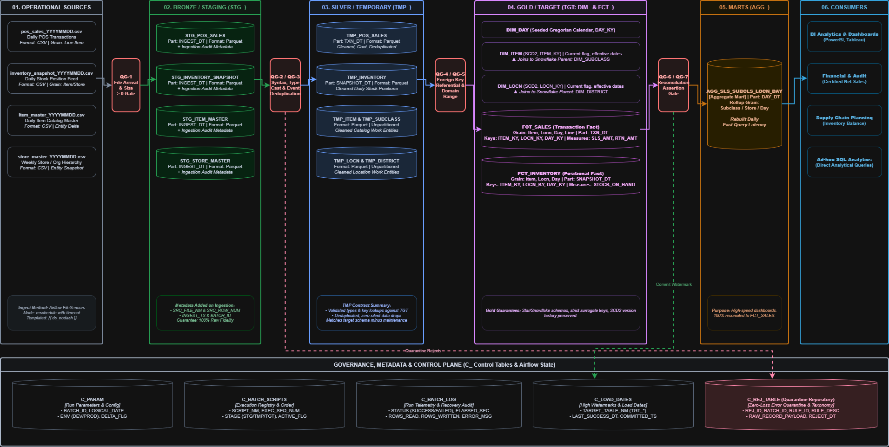

# Medallion Architecture for the Retail Store Data Warehouse

**Assignment 2.2** · Retail Data Warehousing · Module 2

---

## 1. Overview

This document describes how data moves through the Retail Store Data Warehouse. Daily CSV files are loaded into the Bronze layer, cleaned and checked in Silver, and then used to build the Gold dimensional model in Snowflake. Reporting tables are created from the Gold layer.

The design follows three main principles:

1. **Each layer has a clear responsibility.** A layer only passes data on after it has met the checks defined for that layer.
2. **Loads can be rerun safely.** Reprocessing a date should not create duplicate records, change existing surrogate keys unnecessarily, or alter financial totals.
3. **Rejected records are retained.** Rows that fail validation are written to `C_REJ_TABLE` with a rule ID and a description of the problem. They are not silently discarded.

---

## 2. Architecture Diagram



---

## 3. Layer Contracts

Each layer has a specific role. The contracts below describe what each layer is expected to provide and what is handled elsewhere.

### 3.1 Bronze Raw Ingestion

**Purpose:** Store the source files as they arrive, while adding the metadata needed to trace each row back to its file and batch.

**What Bronze provides:**

- Source rows and source columns are retained without cleaning, filtering, or type conversion.
- Each row includes `SRC_FILE_NM`, `SRC_ROW_NUM`, `INGEST_TS`, and `BATCH_ID`.
- Data is organised by `INGEST_DT`, so a date can be reloaded without replacing unrelated dates.

**What Bronze does not provide:**

- Clean data types. Source values are initially stored as `VARCHAR`.
- Deduplication.
- Referential-integrity checks.
- Validation of business rules or value ranges.

### 3.2 Silver Cleaned and Conformed Data

**Purpose:** Convert source values into usable data types, remove duplicate business events, check relationships to master data, and quarantine invalid rows.

**What Silver provides:**

- Typed columns such as `DECIMAL(12,2)`, `INTEGER`, `DATE`, and `TIMESTAMP`. Values that cannot be converted are rejected.
- One retained record for each business event, using the business key and timestamp to identify duplicates.
- Referential-integrity checks against the item and location master data.
- Rejected rows recorded in `C_REJ_TABLE`, including a `RULE_ID` and `RULE_DESC`.

**What Silver does not provide:**

- Surrogate keys. Silver records still use natural keys such as `ITEM_ID`.
- A star-schema structure.
- SCD Type 2 history tracking.

### 3.3 Gold Dimensional Model

**Purpose:** Provide the dimensional model used by reporting and analytics. The Gold layer contains the fact and dimension tables, including their surrogate keys and history where required.

**What Gold provides:**

- Fact tables join to dimensions through surrogate keys such as `ITEM_KY`, `LOCN_KY`, and `DAY_KY`.
- SCD Type 2 changes are tracked. The previous row is closed with `CURR_FLG = 'N'`, and the new version is opened.
- Records that cannot be matched to a dimension can use the Unknown member (`-1`) and are flagged for review.
- Additive measures such as `NET_SLS_AMT` and `NET_SLS_QTY` are reconciled with Silver.

**What Gold does not provide:**

- The original source text in its raw form. That is retained in Bronze.
- A view of quarantined records. Those records remain in `C_REJ_TABLE`.

### 3.4 Marts Reporting Aggregates

**Purpose:** Store prepared summaries that make common reports quicker to run.

**What the marts provide:**

- `AGG_SLS_SUBCLS_LOCN_DAY` is reconciled with the underlying `FCT_SALES` data.
- Each date partition is rebuilt from the source fact data rather than incrementally added to. This avoids accumulating differences across repeated runs.

**What the marts do not provide:**

- Transaction-line detail. Use `FCT_SALES` when an individual transaction line is needed.

---

## 4. Layer Inventory

The following table shows where each source file, table, and control object belongs. It also records the partitioning and expected load pattern.

| Object | Layer | Format | Partitioning | Load pattern |
|:--|:--|:--|:--|:--|
| `pos_sales_YYYYMMDD.csv` | Source | CSV | — | Daily delta |
| `inventory_snapshot_YYYYMMDD.csv` | Source | CSV | — | Daily delta |
| `item_master_YYYYMMDD.csv` | Source | CSV | — | Daily delta |
| `store_master_YYYYMMDD.csv` | Source | CSV | — | Weekly delta |
| `STG_POS_SALES` | Bronze | Table | `INGEST_DT` | Delta |
| `STG_INVENTORY_SNAPSHOT` | Bronze | Table | `INGEST_DT` | Delta |
| `STG_ITEM_MASTER` | Bronze | Table | `INGEST_DT` | Delta |
| `STG_STORE_MASTER` | Bronze | Table | `INGEST_DT` | Delta |
| `TMP_POS_SALES` | Silver | Table | `TXN_DT` | Delta |
| `TMP_INVENTORY` | Silver | Table | `SNAPSHOT_DT` | Delta |
| `TMP_ITEM` | Silver | Table | — | Delta |
| `TMP_SUBCLASS` | Silver | Table | — | Delta |
| `TMP_LOCN` | Silver | Table | — | Delta |
| `TMP_DISTRICT` | Silver | Table | — | Delta |
| `C_PARAM` | Control | Table | — | Seed |
| `C_BATCH_LOG` | Control | Table | `BATCH_START_DT` | Delta |
| `C_LOAD_DATES` | Control | Table | — | Delta |
| `C_REJ_TABLE` | Control | Table | `REJECT_DT` | Delta |
| `DIM_DAY` | Gold | Table | — | Seed |
| `DIM_SUBCLASS` | Gold | Table | — | Delta (SCD1) |
| `DIM_DISTRICT` | Gold | Table | — | Delta (SCD1) |
| `DIM_ITEM` | Gold | Table | — | Delta (SCD2) |
| `DIM_LOCN` | Gold | Table | — | Delta (SCD2) |
| `FCT_SALES` | Gold | Table | `TXN_DT` | Delta |
| `FCT_INVENTORY` | Gold | Table | `SNAPSHOT_DT` | Delta |
| `AGG_SLS_SUBCLS_LOCN_DAY` | Gold | Table | `DAY_DT` | Full rebuild |

---

## 5. Quality Gates

Seven quality gates are used to check data as it moves between layers. Each gate has a defined response when a check fails.

| Gate | Boundary | Check | Action on failure |
|:--|:--|:--|:--|
| **QG-1** | Source → Bronze | The source file exists and is not empty. | **Fail:** Stop the pipeline and wait for the file to be delivered again. |
| **QG-2** | Bronze → Silver | Required keys such as `ITEM_ID` and `LOCN_ID` are not null. | **Quarantine:** Write rows with missing keys to `C_REJ_TABLE`. |
| **QG-3** | Bronze → Silver | No duplicate events based on `TXN_ID`, `LINE_ID`, and `TXN_TS`. | **Quarantine:** Keep the first occurrence and write duplicates to `C_REJ_TABLE`. |
| **QG-4** | Within Silver | `ITEM_ID` exists in `TMP_ITEM`, and `LOCN_ID` exists in `TMP_LOCN`. | **Quarantine and alert:** Write orphan rows to `C_REJ_TABLE` and raise an alert. |
| **QG-5** | Silver → Gold | Business values are valid: `SLS_QTY > 0` and `SLS_AMT >= 0`. | **Quarantine:** Write rows with invalid values to `C_REJ_TABLE`. |
| **QG-6** | Silver → Gold | Each valid row resolves to `ITEM_KY > 0` and `LOCN_KY > 0`. | **Alert:** Assign `-1` (Unknown) to an unmapped key and log the issue. |
| **QG-7** | Silver → Gold → Marts | Reconcile Silver totals with Gold facts, then confirm that mart totals match `FCT_SALES`. | **Fail:** Fail the DAG and do not advance the load watermark. |

### 5.1 Quarantine Table

Rejected records are stored with enough information to identify the source row, the failed rule, and whether the issue has been resolved.

```sql
CREATE TABLE IF NOT EXISTS C_REJ_TABLE (
    REJ_ID              NUMBER(38,0) AUTOINCREMENT START 1 INCREMENT 1,
    BATCH_ID            NUMBER(38,0) NOT NULL,
    LAYER_BOUNDARY      VARCHAR(20) NOT NULL,   -- e.g. 'BRONZE_TO_SILVER'
    SRC_FILE_NM         VARCHAR(255) NOT NULL,
    SRC_ROW_NUM         NUMBER(38,0) NOT NULL,
    RULE_ID             VARCHAR(20) NOT NULL,  -- e.g. 'QG-2', 'QG-5'
    RULE_DESC           VARCHAR(255) NOT NULL,
    BUSINESS_KEY        VARCHAR(100),
    RAW_RECORD_PAYLOAD  VARIANT NOT NULL,      -- full rejected row as JSON
    REJECT_DT           DATE NOT NULL,
    RESOLVED_FLG        CHAR(1) DEFAULT 'N',
    RESOLVED_TS         TIMESTAMP_NTZ,
    REC_INS_TS          TIMESTAMP_NTZ DEFAULT CURRENT_TIMESTAMP(),
    CONSTRAINT PK_C_REJ_TABLE PRIMARY KEY (REJ_ID)
);
```

> **Snowflake note:** Standard Snowflake tables do not enforce primary-key constraints. The `REJ_ID` column is generated with `AUTOINCREMENT`; the constraint documents the intended key rather than enforcing uniqueness.

---

## 6. Retention Policy

The retention periods below define how long data remains readily available and what happens to it afterwards.

| Layer | Active retention | Archive / cold storage | Purge method |
|:--|:--|:--|:--|
| **Bronze** | 90 days, to support reruns | 7 years in WORM cold storage | Lifecycle policy based on `INGEST_DT` |
| **Silver** | 180 days, to allow re-modelling | Archive after 1 year; delete after 3 years | Monthly partition-pruning DAG |
| **Gold** | Indefinite; full history remains online | Clustered by year in the warehouse | No automated deletion; this is the authoritative analytical layer |
| **Control** | 90 days for operational debugging | Annual summaries; raw reject payloads removed after 1 year | Remove `C_REJ_TABLE` rows older than 365 days |

---

## 7. Reload Policy: Reprocessing a Date

If a source file is corrected and delivered again (for example, `pos_sales_20260303.csv`), the pipeline reloads the affected date and then rebuilds the downstream data that depends on it.

### Step 1: Check the rejected records

- Review `C_REJ_TABLE` for the relevant batch and date.
- Confirm that the corrected file is available in the source drop folder.

### Step 2: Reload the Bronze partition

- Load the corrected file into `STG_POS_SALES` for `INGEST_DT = '2026-03-03'`.
- Replace the affected partition and assign a new `BATCH_ID`.

### Step 3: Rebuild the Silver partition

- Rerun the cleaning and deduplication steps for `TXN_DT = '2026-03-03'`.
- Replace the matching partition in `TMP_POS_SALES`.
- Update the relevant resolution flags in `C_REJ_TABLE`.

### Step 4: Check the Gold SCD2 dimensions

- Compare the corrected Silver data with `DIM_ITEM` and `DIM_LOCN`.
- If an incorrect version was created with `EFF_FROM_DT = '2026-03-03'`:
  - Close the incorrect version by setting `CURR_FLG = 'N'`.
  - Reopen the previous valid version.
  - Apply the corrected version with `EFF_FROM_DT = '2026-03-03'`.

### Step 5: Replace the Gold sales facts

Run the delete and insert for the same date in a single transaction. The `SELECT ...` below is a placeholder for the actual column mapping:

```sql
DELETE FROM FCT_SALES
WHERE TXN_DT = '2026-03-03';

INSERT INTO FCT_SALES
-- Select the corrected rows from TMP_POS_SALES for this date.
SELECT ...
FROM TMP_POS_SALES
WHERE TXN_DT = '2026-03-03';
```

### Step 6: Refresh the inventory facts

- Replace the `FCT_INVENTORY` data for `SNAPSHOT_DT = '2026-03-03'`.
- Recheck the effective date ranges to keep the snapshot sequence consistent.

### Step 7: Rebuild the aggregate mart

- Remove the existing aggregate rows for `DAY_DT = '2026-03-03'`.
- Recalculate and insert the aggregates from `FCT_SALES` for the same date. The `SELECT ...` is a placeholder for the actual grouping and column mapping.

```sql
DELETE FROM AGG_SLS_SUBCLS_LOCN_DAY
WHERE DAY_DT = '2026-03-03';

-- Reinsert the recalculated subclass, location, and day totals.
INSERT INTO AGG_SLS_SUBCLS_LOCN_DAY
SELECT ...
FROM FCT_SALES
WHERE TXN_DT = '2026-03-03';
```

### Step 8: Reconcile and complete the reload

- Run quality gate `QG-7`.
- If the checks pass, update `C_LOAD_DATES` and record the batch as successful.
- If the checks fail, roll back the transaction and fail the DAG. Do not advance the load watermark.

### Why the reload process is safe

- **Bronze** is partitioned by `INGEST_DT`, so the reload targets the affected date rather than replacing the full staging table.
- **Silver** is partitioned by fields such as `TXN_DT` and `SNAPSHOT_DT`. Airflow's `logical_date` can be used to select the partition being rebuilt.
- **Gold fact tables** are refreshed for the affected date. The delete and insert should run in the same transaction so the partition is not left partially replaced.
- **SCD2 dimensions** are not date-partitioned because they maintain a continuous history. The merge logic should recognise an existing version for the target `EFF_FROM_DT` and update it rather than creating another version on a rerun.
- **Aggregate tables** are rebuilt from the fact data instead of incremented, which avoids double-counting when a date is processed more than once.

---

## 8. Design Decisions That Differ from a Standard Kimball Model

This design makes two choices that differ from a typical flattened Kimball model. Both are intended to make the warehouse easier to maintain.

### 8.1 Keep Parent Dimensions Separate in Gold

A common Kimball approach is to flatten a hierarchy into one dimension. For example, subclass, class, and department attributes could all be stored in `DIM_ITEM`.

This design keeps `DIM_SUBCLASS` and `DIM_DISTRICT` as separate parent dimensions instead.

**Reason for this choice:**

- In a large retail catalogue, changing the classification of one subclass could otherwise require SCD2 changes for every item in that subclass. For a subclass with 50,000 items, that could mean creating tens of thousands of new surrogate-key versions. Keeping the parent dimension separate limits the change to the relevant parent record.
- The product hierarchy is maintained by merchandising planning, while item records are maintained by inventory operations. Separate tables make that division of responsibility clearer.

### 8.2 Store Rejected Records in a SQL Table

Rejected rows are sometimes sent to a dead-letter queue or stored as files in object storage such as S3 or GCS. This design stores them in the relational table `C_REJ_TABLE`.

**Reason for this choice:**

- The pipeline can compare the number of Bronze rows with the number of valid Silver rows and rejected rows using SQL. This makes reconciliation easier to run and monitor.
- Analysts can query rejected records, check their source files, and see whether an issue has been resolved by using `RESOLVED_FLG`. They do not need a separate tool to inspect the rejects.

---

## 9. Deliverables Checklist

- [x] **Architecture diagram** — shows the flow from source files through Bronze, Silver, Gold, marts, and reporting consumers.
- [x] **`layer_inventory.csv`** — maps the warehouse objects to their layers, formats, partitioning, and load patterns.
- [x] **`architecture_notes.md`** — documents the layer contracts, seven quality gates, retention policy, and reload process.
- [x] **Reload policy** — describes the steps for reprocessing a date and rebuilding the affected downstream data.
- [x] **Design justification** — explains why the parent dimensions remain separate and why rejected records are stored in `C_REJ_TABLE`.
